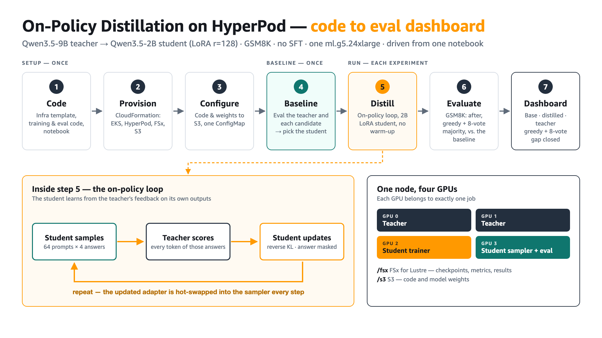

# On-policy distillation on SageMaker HyperPod (EKS) — end-to-end runbook



Distils **Qwen3.5-9B** into **Qwen3.5-2B** (LoRA rank 128) on GSM8K with on-policy distillation and
no supervised warm-up, evaluated on all 1,319 GSM8K test problems: the base student and the teacher
greedy, the distilled student greedy and with an 8-vote majority. The workflow starts with a
**baseline eval** of the teacher and each candidate student and picks the student from a comparison
dashboard. Measured results and experiment history:
[`code/experiments/`](code/experiments/). A more detailed version of the diagram is in
[`slides/workflow-detailed.png`](slides/workflow-detailed.png).

Deploy one CloudFormation template, open JupyterLab in SageMaker Studio, run
`on_policy_distillation.ipynb`. The template creates the HyperPod cluster, the shared
storage, the observability stack, a Studio domain **and** a JupyterLab space that clones
your copy of this repository (`GitRepositoryUrl`) into itself on every start.

| Directory | Contents |
| --- | --- |
| [`infra/`](./infra) | `hyperpod-eks-onpolicy-distillation.yaml` — the whole stack. See [`infra/README.md`](./infra/README.md) for the resource inventory and design notes. |
| [`code/`](./code) | The notebook, the trainer (`src/`) and the Kubernetes manifests (`manifests/`) — this is what lives in the Git repository the space clones. See [`code/README.md`](./code/README.md). |
| [`slides/`](./slides) | The workflow diagrams (HTML sources plus PNG/PDF renders). |

---

## Step 0 — Prerequisites

1. **HyperPod capacity.** Request a HyperPod cluster quota for the accelerated instance
   type (default `ml.g5.24xlarge`) in your target region. Without quota the
   `AWS::SageMaker::Cluster` resource fails and the stack rolls back.
2. **A region with at least four Availability Zones** (the template uses `Fn::GetAZs`).
3. **AWS IAM Identity Center enabled** in that region *if* you keep
   `CreateGrafanaWorkspace=true`. Otherwise pass `CreateGrafanaWorkspace=false`.
4. **AWS CLI v2** and credentials that can create IAM roles, EKS, SageMaker, FSx, S3,
   CodeBuild and Lambda resources.
5. **A Git repository with this code, reachable over HTTPS.** The lifecycle configuration
   clones `GitRepositoryUrl` into the space; an empty repository gives you an empty
   directory. The lifecycle script looks for `manifests/env_vars` anywhere up to four levels
   deep, so either layout (repo root = `code/`, or repo root contains `code/`) works.

## Step 1 — Deploy the stack

The template is ~85 KB, above CloudFormation's 51,200-byte limit for an inline template
body, so it has to be staged in S3. `--s3-bucket` makes the CLI do that for you:

```bash
STAGING_BUCKET=cfn-staging-$(aws sts get-caller-identity --query Account --output text)-us-west-2
aws s3 mb "s3://$STAGING_BUCKET" --region us-west-2   # once

aws cloudformation deploy \
  --stack-name hp-onpolicy-distillation \
  --template-file infra/hyperpod-eks-onpolicy-distillation.yaml \
  --s3-bucket "$STAGING_BUCKET" \
  --capabilities CAPABILITY_NAMED_IAM \
  --region us-west-2 \
  --parameter-overrides \
      ResourceNamePrefix=hp-onpolicy-distill \
      HyperPodClusterName=hp-cluster-onpolicy-distillation \
      AcceleratedInstanceType=ml.g5.24xlarge \
      AcceleratedInstanceCount=1 \
      GitRepositoryUrl=<your-git-repo-url> \
      CreateStudioSpace=true \
      StudioSpaceName=opd-jupyterlab \
      StudioSpaceInstanceType=ml.m5.2xlarge \
      AdminPrincipalArn=arn:aws:iam::<account-id>:role/<your-role>
```

Without IAM Identity Center in the region, add `CreateGrafanaWorkspace=false`. In the
console, use **CloudFormation → Create stack → Upload a template file** instead — the
console stages the file for you.

Notebook-related parameters:

| Parameter | Default | What it does |
| --- | --- | --- |
| `GitRepositoryUrl` | *(required)* | HTTPS URL of your copy of this repository: cloned into the space by the lifecycle configuration, and registered as a code repository in JupyterLab |
| `GitRepositoryBranch` | *(blank)* | Branch to check out; blank clones the default branch |
| `CreateStudioSpace` | `true` | Create the private JupyterLab space `opd-jupyterlab` owned by the `distillation-researcher` user profile |
| `StudioSpaceName` | `opd-jupyterlab` | Space name |
| `StudioSpaceInstanceType` | `ml.m5.2xlarge` | Instance behind the space. The notebook only drives `kubectl`, so CPU is enough — training runs on the HyperPod GPU nodes |
| `StudioSpaceEbsVolumeSizeInGB` | `100` | Space EBS volume |

Expect **45–70 minutes**: EKS + add-ons ~15 min, FSx ~10 min, the Helm bootstrap ~5 min,
the HyperPod cluster ~15–25 min depending on capacity allocation.

Follow along, and if it fails look at the failing resource's status reason first:

```bash
aws cloudformation describe-stack-events --stack-name hp-onpolicy-distillation \
  --region us-west-2 --max-items 30 \
  --query 'StackEvents[?ResourceStatus==`CREATE_FAILED`].[LogicalResourceId,ResourceStatusReason]' \
  --output table
```

The two bootstrap phases (`HelmDependencies`, `StorageBootstrap`) log to CloudWatch at
`/aws/codebuild/hp-onpolicy-distill-bootstrap`.

## Step 2 — Collect the outputs

```bash
aws cloudformation describe-stacks --stack-name hp-onpolicy-distillation \
  --region us-west-2 --query 'Stacks[0].Outputs[].[OutputKey,OutputValue]' --output table
```

The ones you need next: `StudioDomainId`, `StudioSpaceJupyterLabUrl`,
`HyperPodClusterName`, `EKSClusterName`, `S3BucketName`.

Sanity-check the cluster before opening the notebook:

```bash
aws eks update-kubeconfig --region us-west-2 --name <EKSClusterName>
kubectl get nodes -L sagemaker.amazonaws.com/instance-group-name   # nodes Ready
kubectl get pvc                                                    # fsx-claim, s3-claim → Bound
aws sagemaker describe-cluster --cluster-name hp-cluster-onpolicy-distillation \
  --region us-west-2 --query ClusterStatus
```

## Step 3 — Open JupyterLab

There are two different kinds of space, and this stack supports both:

| | Runs on | Created by | Repository clone |
| --- | --- | --- | --- |
| **A. Studio JupyterLab space** | a Studio-managed instance (`StudioSpaceInstanceType`) | this stack (`StudioSpace`) | automatic, via the Studio lifecycle configuration |
| **B. SageMaker Space on HyperPod** | a node inside the HyperPod cluster | you, with `hyp` or `kubectl` | manual, or a `postStart` hook |

Option A is the shortest path to running the notebook. Option B puts the IDE on the
cluster itself, next to the GPUs and with `/fsx` and `/s3` mounted from the same PVCs the
training pods use.

### Option A — the Studio JupyterLab space the stack creates

The domain uses `AuthMode: IAM`, so get a presigned URL (or use the console: **SageMaker
AI → Domains → your domain → user profile `distillation-researcher` → Launch → Studio**):

```bash
aws sagemaker create-presigned-domain-url \
  --domain-id <StudioDomainId> \
  --user-profile-name distillation-researcher \
  --region us-west-2 --query AuthorizedUrl --output text
```

In Studio choose **JupyterLab** in the left sidebar. The space `opd-jupyterlab` is already
there — **Run** it, then **Open**. First start takes a few minutes while the instance and
the EBS volume come up.

If you set `CreateStudioSpace=false`, or want a second space, the same thing from the CLI
(this is exactly what the `StudioSpace` resource does):

```bash
DOMAIN_ID=<StudioDomainId>
LCC_ARN=<StudioLifecycleConfigArn>

cat > /tmp/space-settings.json <<JSON
{
  "AppType": "JupyterLab",
  "RemoteAccess": "ENABLED",
  "SpaceStorageSettings": {"EbsStorageSettings": {"EbsVolumeSizeInGb": 100}},
  "JupyterLabAppSettings": {
    "CodeRepositories": [{"RepositoryUrl": "<your-git-repo-url>"}],
    "DefaultResourceSpec": {"InstanceType": "ml.m5.2xlarge", "LifecycleConfigArn": "$LCC_ARN"}
  }
}
JSON

aws sagemaker create-space --region us-west-2 \
  --domain-id "$DOMAIN_ID" \
  --space-name opd-jupyterlab-cli \
  --space-display-name opd-jupyterlab-cli \
  --ownership-settings OwnerUserProfileName=distillation-researcher \
  --space-sharing-settings SharingType=Private \
  --space-settings file:///tmp/space-settings.json

# "Run" the space (Studio does this for you when you click Run)
aws sagemaker create-app --region us-west-2 \
  --domain-id "$DOMAIN_ID" --space-name opd-jupyterlab-cli \
  --app-type JupyterLab --app-name default \
  --resource-spec InstanceType=ml.m5.2xlarge,LifecycleConfigArn="$LCC_ARN"

aws sagemaker describe-app --region us-west-2 --domain-id "$DOMAIN_ID" \
  --space-name opd-jupyterlab-cli --app-type JupyterLab --app-name default \
  --query Status
```

### Option B — a SageMaker Space on the HyperPod cluster

HyperPod spaces are **not** Studio spaces, and `aws sagemaker create-space` cannot create
one: there is no HyperPod field anywhere in `CreateSpace`. The `amazon-sagemaker-spaces`
add-on this stack installs runs the `jupyter-k8s` controller in the EKS cluster and
registers a `Workspace` CRD, so a HyperPod space is a Kubernetes object created with the
HyperPod CLI, `kubectl`, or the HyperPod console — see
[Create and manage spaces](https://docs.aws.amazon.com/sagemaker/latest/dg/create-manage-spaces.html)
and [IDEs and Notebooks](https://docs.aws.amazon.com/sagemaker/latest/dg/sagemaker-hyperpod-eks-cluster-ide.html).

```bash
pip install sagemaker-hyperpod                                   # provides the `hyp` CLI
aws eks update-kubeconfig --region us-west-2 --name <EKSClusterName>
hyp set-cluster-context --cluster-name hp-cluster-onpolicy-distillation --region us-west-2

kubectl get pods -n jupyter-k8s-system                           # controller is Running
kubectl get workspacetemplates -A                                # sagemaker-jupyter-template, sagemaker-code-editor-template
kubectl get localqueues -A                                       # task governance is installed — note the queue name
```

Create a JupyterLab space on a general-purpose node, with the shared volumes mounted:

```bash
hyp create hyp-space \
  --name opd-space --display-name opd-space --namespace default \
  --template-ref name=sagemaker-jupyter-template,namespace=jupyter-k8s-system \
  --node-selector '{"node.kubernetes.io/instance-type":"ml.m5.4xlarge"}' \
  --cpu 4 --memory 16Gi \
  --volume name=fsx-data,mountPath=/fsx,persistentVolumeClaimName=fsx-claim \
  --volume name=s3-data,mountPath=/s3,persistentVolumeClaimName=s3-claim \
  --env '[{"name":"HP_CLUSTER_NAME","value":"hp-cluster-onpolicy-distillation"},
          {"name":"S3_BUCKET","value":"<S3BucketName>"},
          {"name":"AWS_DEFAULT_REGION","value":"us-west-2"}]' \
  --queue-name <local-queue>
```

`--queue-name` is required while the `amazon-sagemaker-hyperpod-taskgovernance` add-on is
installed (it sets `kueue.x-k8s.io/queue-name`); drop it if you removed task governance.
Keep the space on `ml.m5.4xlarge` so it does not consume a GPU — the notebook only drives
`kubectl`. Add `--gpu 1` only if you want to run training interactively in the space.

The `kubectl` equivalent:

```bash
kubectl apply -f - <<'EOF'
apiVersion: workspace.jupyter.org/v1alpha1
kind: Workspace
metadata:
  name: opd-space
  namespace: default
spec:
  displayName: opd-space
  desiredStatus: Running
  appType: jupyterlab
  templateRef: {name: sagemaker-jupyter-template, namespace: jupyter-k8s-system}
  nodeSelector: {node.kubernetes.io/instance-type: ml.m5.4xlarge}
  resources:
    requests: {cpu: '4', memory: 16Gi}
    limits: {cpu: '4', memory: 16Gi}
  volumes:
    - {name: fsx-data, mountPath: /fsx, persistentVolumeClaimName: fsx-claim}
    - {name: s3-data,  mountPath: /s3,  persistentVolumeClaimName: s3-claim}
EOF
```

Manage and connect:

```bash
hyp list hyp-space                                   # AVAILABLE goes True after a few minutes
hyp describe hyp-space --name opd-space
hyp get-logs hyp-space --name opd-space

# Browser: port-forward, then open http://localhost:8888
hyp portforward hyp-space --name opd-space --local-port 8888

# Local IDE over SSH-over-SSM (prints a SpaceConnectionUrl)
hyp create hyp-space-access --name opd-space --connection-type vscode-remote

hyp stop hyp-space --name opd-space                   # frees the pod, keeps the space
hyp delete hyp-space --name opd-space
```

Two caveats for this path:

- **`--connection-type web-ui` needs the cluster web UI**, i.e.
  `jupyter-k8s-aws-hyperpod.clusterWebUI.enabled=true` in the add-on configuration plus a
  DNS domain, an ACM certificate and the bundled Traefik ingress. This stack leaves it off,
  so use port forwarding or a remote IDE. The remote-IDE tunnel also registers an SSM
  advanced on-premises instance, which is billed per hour.
- **The Studio lifecycle configuration does not run here** — it is a Studio construct. Clone
  in the space terminal, or attach a `postStart` hook at creation:

  ```bash
  --lifecycle '{"postStart":{"exec":{"command":["/bin/bash","-lc",
    "git clone <your-git-repo-url> /home/sagemaker-user/<repo-name> || true"]}}}'
  ```

  `lifecycle` is passed through to the workspace container's Kubernetes lifecycle hook;
  verify with `kubectl get workspace opd-space -o yaml` and
  `kubectl describe pod -l workspace.jupyter.org/workspace-name=opd-space`.

## Step 4 — Verify the clone

Option A only — a HyperPod space (option B) has no Studio lifecycle configuration, so check
whatever you cloned by hand there instead. Open a terminal in JupyterLab
(**File → New → Terminal**):

```bash
ls ~/<repo-name>                  # the cloned repository
cat ~/opd-env.sh                  # cluster coordinates, sourced from ~/.bashrc
tail -30 ~/.opd-lifecycle.log     # what the lifecycle configuration did
grep -rE '^export (CTX|S3_BUCKET|REGION)=' ~/<repo-name> --include=env_vars
```

`~/opd-env.sh` exports `HP_CLUSTER_NAME`, `EKS_CLUSTER_NAME`, `EKS_CLUSTER_ARN`, `CTX`,
`S3_BUCKET`, `FSX_FILE_SYSTEM_ID` and `REGION`, and the script pre-fills the three blank
values in `manifests/env_vars` (`CTX`, `S3_BUCKET`, `REGION`) — the original is kept as
`env_vars.orig`.

If the repository is missing, either the repo was empty at deploy time or the clone failed:
clone it by hand (`git clone <your-git-repo-url> ~/<repo-name>`) or use the JupyterLab git
panel, where the repository is already listed. Then re-run the
lifecycle script by restarting the space.

## Step 5 — Run `on_policy_distillation.ipynb`

Open `on_policy_distillation.ipynb` from the cloned repository (`~/<repo-name>/` or
`~/<repo-name>/code/`, depending on your repository layout) and pick the **Python 3 (ipykernel)** kernel.

> **JupyterLab spaces hosted on the HyperPod nodes** (created through the `amazon-sagemaker-spaces`
> add-on) run as a Kubernetes pod and do not receive the Studio execution role, so `aws` and
> `kubectl` have no credentials there. Set the space's service account to `opd-workspace`
> (`kubectl patch workspaces.workspace.jupyter.org <space> --type merge -p
> '{"spec":{"serviceAccountName":"opd-workspace"}}'`). The stack creates that account, binds it to
> `<prefix>-hyperpod-space-role` through EKS Pod Identity, and grants the role edit access to the
> `default` namespace plus read-only access cluster-wide. The spaces add-on only lets a user attach
> a non-default service account listed in its `workspace.jupyter.org/service-account-user-patterns`
> annotation; the stack allows any role session in the account (narrow it to one role if needed).

1. **Part 0 — Setup.** Edit the first code cell: `HP_CLUSTER_NAME=<your-hyperpod-cluster-name>` must become
   your cluster name.

   ```bash
   HP_CLUSTER_NAME=hp-cluster-onpolicy-distillation
   ```

   Run the cell. It resolves the EKS cluster ARN into `bash_env` (used as the `kubectl`
   context) and installs `kubectl` into `~/bin`. If the kubectl download fails — the cell
   scrapes the AWS docs for the URL — install it manually in a terminal and re-run:

   ```bash
   mkdir -p ~/bin && cd ~/bin
   curl -LO "https://dl.k8s.io/release/$(curl -Ls https://dl.k8s.io/release/stable-1.34.txt)/bin/linux/amd64/kubectl"
   chmod +x kubectl
   ```

   Then run the remaining Part 0 cells. They print the EKS cluster ARN and the bucket
   behind `s3-claim`; both are already in `manifests/env_vars`, so there is nothing to
   paste unless the lifecycle configuration could not patch the file.

2. **Check the node label the manifests select on.** Both manifests pin pods with
   `nodeSelector: node.kubernetes.io/instance-type: $INSTANCE_TYPE`. Confirm the value your
   nodes actually report and fix `INSTANCE_TYPE` in `manifests/env_vars` if it differs:

   ```bash
   kubectl get nodes -o custom-columns='NAME:.metadata.name,TYPE:.metadata.labels.node\.kubernetes\.io/instance-type'
   ```

3. **Part 1 — Baseline eval and model selection.** Creates the `teacher-vllm` Deployment +
   ClusterIP Service serving bf16 `Qwen/Qwen3.5-9B`, sharded over GPUs 0-1 (TP=2) — weights are
   pulled from Hugging Face into the FSx cache (`HF_HOME=/fsx/hf_cache`) on first run, so
   `rollout status` can take 10+ minutes. It then evaluates the teacher and each candidate student
   (`Qwen/Qwen3.5-0.8B`, `Qwen/Qwen3.5-2B`; the sampler serves one at a time) on all 1,319 GSM8K
   test problems, ~45 min in total, and draws a comparison dashboard that picks the student.

4. **Part 2 — Launch the sampler and the student.** Applies the `student-sampler` vLLM
   Deployment (GPU 3) for the chosen student, syncs `src/` to `s3://$S3_BUCKET/opd/src` (the pod
   reads it at `/s3/opd/src`) and submits the `opd-student` Job (GPU 2), which runs `preflight.py`
   and then `train_distill.py`: 50 steps of 64 prompts × 4 rollouts, ~4.5 h (the accuracy plateau
   is reached by step 25).

5. **Part 3 — Monitor.** Plots `teacher_kl`, capped rollouts and rollout length from
   `${RUN_DIR}/metrics_rank0.jsonl`; re-run the cells to refresh. Read `teacher_kl` together with
   length — rambling text lowers it without any learning. Cluster and GPU metrics also land in
   Amazon Managed Prometheus — use the `GrafanaWorkspaceEndpoint` output if you created the
   Grafana workspace.

6. **Part 4 — Evaluate.** Scores each `student-step<N>` checkpoint on all 1,319 GSM8K test
   problems, reusing the Part 1 baseline for the base student and the teacher, reports the share of
   the teacher gap closed, and redraws the comparison dashboard with the distilled student added.
   It needs no GPU, so it can run while training continues.

7. **Part 5 — Cleanup.** Deletes the Jobs, the sampler and the teacher, freeing the GPUs but
   leaving the cluster up.

The default GPU node (`ml.g5.24xlarge`, 4× A10G) is partitioned exactly: teacher 2 GPUs,
trainer 1, sampler 1. If you scale `GPU_PER_NODE` or add teacher replicas, add nodes as well.

## Step 6 — Cleanup

Stop the JupyterLab app first: a running app blocks deletion of the space, which blocks
deletion of the domain and therefore the stack.

```bash
aws sagemaker delete-app --domain-id <StudioDomainId> --space-name opd-jupyterlab \
  --app-type JupyterLab --app-name default --region us-west-2   # or "Stop" in the Studio UI

# If you created a HyperPod space (option B), delete it too — it lives in the EKS cluster,
# not in the stack, so CloudFormation will not remove it.
hyp delete hyp-space --name opd-space

aws cloudformation delete-stack --stack-name hp-onpolicy-distillation --region us-west-2
```

Left behind on purpose: the S3 data and access-log buckets, the Amazon Managed Prometheus
workspace (all `DeletionPolicy: Retain`), and the EFS volume Studio created for home
directories. The **FSx for Lustre file system is deleted** with the stack and has no
backup — copy anything you need off `/fsx` first.

## Troubleshooting

| Symptom | Where to look |
| --- | --- |
| Stack rolls back on `HyperPodCluster` | Capacity/quota for the accelerated instance type in that region |
| Stack fails on `GrafanaWorkspace` | IAM Identity Center is not enabled — redeploy with `CreateGrafanaWorkspace=false` |
| `HelmDependencies` / `StorageBootstrap` failed | CloudWatch log group `/aws/codebuild/<prefix>-bootstrap` |
| Repository not cloned in the space | `~/.opd-lifecycle.log` in the space; Studio's `LifecycleConfigFailure` in the app details; empty upstream repository |
| Space stuck in `Pending` | App details in the Studio UI; a failing lifecycle configuration is the usual cause |
| `hyp create hyp-space` rejected | Missing `--queue-name` while task governance is installed (`kubectl get localqueues -A`), or no `sagemaker-jupyter-template` — check `kubectl get pods -n jupyter-k8s-system` |
| HyperPod space never becomes `AVAILABLE` | `hyp get-logs hyp-space --name <name>`, `kubectl describe pod -l workspace.jupyter.org/workspace-name=<name>`, and `kubectl logs -n jupyter-k8s-system deployment/jupyter-k8s-controller-manager` |
| Pods stay `Pending` | `kubectl describe pod <name>` — usually the `node.kubernetes.io/instance-type` selector, or no free GPU |
| `kubectl` says forbidden | Confirm the notebook is running under `<prefix>-studio-exec-role`, which holds an `AmazonEKSClusterAdminPolicy` access entry |
| Teacher never becomes ready | `kubectl logs deploy/teacher-vllm` — model download, or `--max-model-len` too large for the GPU |
